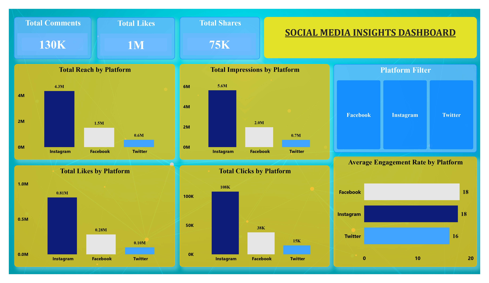

# Social Media Insights Analysis – NEXLEVR Task 2

## Project Overview
This project analyzes social media post performance across Facebook, Instagram, and Twitter for October–December 2023.

## Tools Used
- Microsoft Power BI
- Microsoft PowerPoint
- Data Analysis and Visualization

## Key Metrics
- Likes
- Comments
- Shares
- Clicks
- Impressions
- Reach
- Average Engagement Rate

## Project Deliverables
- Power BI interactive dashboard
- PowerPoint presentation
- Three-month social media performance analysis
- Key insights and recommendations

## Objective
To compare platform performance, understand audience engagement, and provide data-driven recommendations for improving social media strategy.

## Dataset
Practice dataset used for analysis. The findings should be interpreted within the scope of this dataset.

## Dashboard Preview

## Author
Neeraj J.
